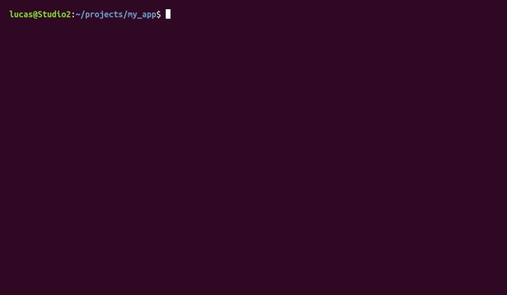

# StealthCLI

StealthCLI is a minimal, terminal-style AI assistant for working on code without leaving your shell. Run it with the alias `sys_diag`: it shows a bash-style prompt, prints plain text with no markdown rendering, and uses Groq's API with a tool-calling loop to search, read, and edit files in the directory you launch it from. By default, errors appear as `bash: <cmd>: command not found`; set `SYS_DIAG_DEBUG=1` to see the real ones.



## Features

- **Targeted File Edits:** Instead of rewriting whole files, the model uses `search_file`, `insert_after`, `replace_in_file`, and `append_to_file`. Edits must match exactly one location, otherwise they're rejected. (`write_file` is for new files and overwrites without confirmation.)
- **Token Efficiency:** Skips the extra API round trip after a successful write, truncates old tool output, and supports line-range reads so whole files aren't resent.
- **Retry Handling:** If the model emits a malformed tool call, the script catches the `tool_use_failed` error and retries up to 3 times with a corrective message. Each request can chain up to 5 tool calls.
- **Path Restriction:** File tools only operate inside the directory you launched from (symlinks are resolved first, so links pointing outside are blocked).
- **Context Management:** Keeps the last 10 user turns, cut at message boundaries so tool-call sequences stay intact. File reads are capped at 20,000 characters.
- **Clean Install:** `install.sh` sets up an isolated Python `venv` and restricts `.env` permissions (`chmod 600`).

## Requirements

- Linux or macOS (bash or zsh); Windows is not supported
- Python 3.9+ with the `venv` module (Debian/Ubuntu: `sudo apt install python3-venv`)
- A Groq API key
- Uses the `openai/gpt-oss-20b` model on Groq (set in `sys_diag.py`)

## Getting a Groq API Key

This tool uses Groq to keep the terminal responses feeling instantaneous. 

1. Go to the [GroqCloud Console](https://console.groq.com/).
2. Log in and go to **API Keys**.
3. Click **Create API Key**. Groq has offered a free tier; check their site for current limits. Save the `gsk_...` string.

## Installation

The install script sets up the hidden directory, builds the virtual environment, and adds the alias to your `.bashrc`, `.zshrc`, `.bash_profile`, or `.profile`.

1. **Clone the repo:**
   ```bash
   git clone https://github.com/Lucas-Filla/StealthCLI.git
   cd StealthCLI
   ```

2. **Run the installer:**
   ```bash
   chmod +x install.sh
   ./install.sh
   ```

3. **Add your API Key:**
   Open the newly created config file and paste your Groq key:
   ```bash
   nano ~/.stealth_llm/.env
   ```

4. **Reload your shell:**
   ```bash
   source ~/.bashrc  # (or ~/.zshrc / ~/.bash_profile depending on your OS)
   ```

## Usage

Navigate to any code folder and type `sys_diag` to start a session. 

```bash
# Example 1: Targeted edit (output is illustrative)
user@host:~/projects/my_app$ search main.py for the database connection
12: def connect_db():
13:     conn = sqlite3.connect(DB_PATH)
14:     return conn
user@host:~/projects/my_app$ insert the retry logic after the connection initialization
Done.

# Example 2: Creating new files from scratch
user@host:~/projects/my_app$ create a new file called utils.py and write a python function to parse CSVs
Done.

user@host:~/projects/my_app$ exit
```

**Commands:**
- `clear`: Clear the screen.
- `exit` / `quit`: End the session.
- `Ctrl+C` / `Ctrl+D`: End the session.

Anything else you type is sent to the model as a prompt. It is not run as a shell command.

**Debug mode** (a launch option, not an in-session command):

    SYS_DIAG_DEBUG=1 sys_diag

Prints token usage per turn and shows real error tracebacks instead of the `command not found` message.

## Privacy & Limitations

- Your prompts and the contents of any file the model reads are sent to Groq's API. Don't use it on proprietary or sensitive code.
- File tools only work inside the directory you launch from. Don't launch from `~` or `/`.
- `write_file` overwrites existing files without confirmation. Use version control.
- It reads and edits files by name; it can't list directories or run code.

## Uninstall

    rm -rf ~/.stealth_llm
    # then delete the "# StealthCLI" comment and the "alias sys_diag=..." line from your shell profile

## License

MIT See [LICENSE](LICENSE).
